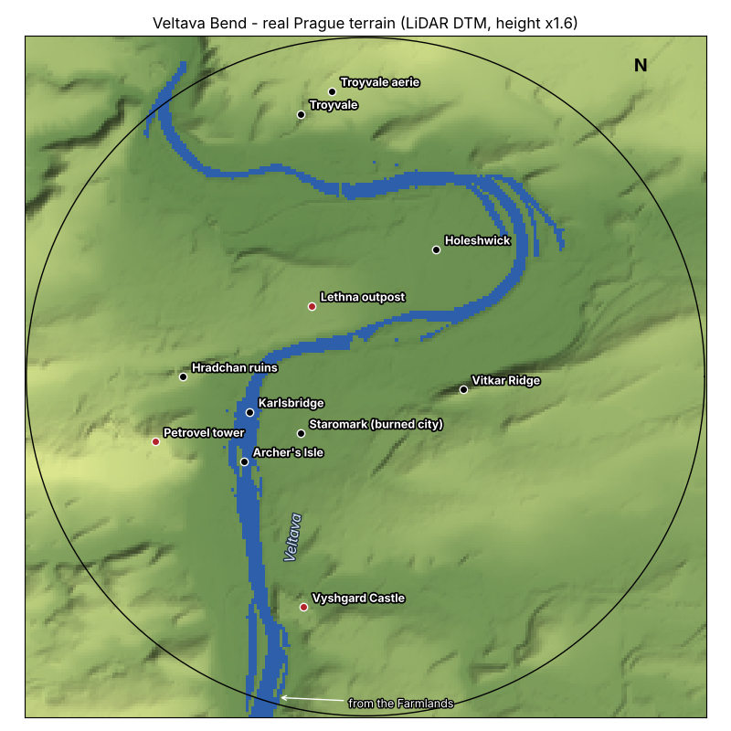

# Phase 3 - Castle, Map + Missions: Implementation Spec

Status: draft, 2026-10-31. Refines `000_spec.md` for Phase 3. Built on `campaign-phase-3` (branched from the finished `campaign-phase-2`). Task branches are `agent/t2NN-...` (T01 -> `t201`).

Revised by Pavel, 2026-10-31:
- **Visual form comes first.** The phase opens with the first Order castle as a showpiece, before the mission systems.
- **The castle gets its own land.** A new region, the **Veltava Bend**, is built on the real terrain of Prague (a LiDAR terrain model, section 4.2) with the iconic shape of the Vltava: the river comes from the south past a rock, runs north through the old city, turns east under a plateau, loops around a peninsula and turns back west and north. The castle stands on the rock where Vyšehrad stands: **Vyshgard Castle**.
- **Fantasy names that are easy to guess** (Veltava, Vyshgard, Hradchan, Petrovel, Lethna, Holeshwick, Troyvale, Staromark, Karlsbridge; table in 4.2).
- **New regions follow Prague's landscape.** The Veltava Bend is the first; the river runs through the later ones too, built the same way from real terrain.
- The map screen stays in this phase and becomes a drawn, explorable map, not only a region graph.

## 1. Goal

The dragon gets a new land to fly over, a real enemy stronghold to raid, a map to find its way around the world and its first timed missions. A Drake flies from the Farmlands into the Veltava Bend, follows the river north and sees Vyshgard Castle on its rock above the water. It flies over the walls under archer and ballista fire, burns wooden roofs, steals the Ember Chalice from the twin-spired chapel against the clock and banks it in an aerie. The cave gets the mission board, the trophy wall and the map stone.

The phase starts with the castle block (castle look in a preview page, the new region, the castle in it, its defenders and fire; checked by Pavel on a phone), then the map and aeries, then missions, story cards and the freed village.

**Exit criteria**

- On a phone, the Veltava Bend reads as Prague's river from above: on the map and from high flight, the river shape (south run, bend under the plateau, loop around the peninsula, turn back north-west) is recognisable, with its islands, hills and a stone bridge.
- Vyshgard Castle reads as a castle on its rock from at least 600 units away (rock cliff over the river, walls and bastions, towers, keep, twin spires, banners) and is the strongest image of the region by day and by night (torches, lit windows).
- A Drake lands in the castle courtyard or on a wall walk, walks between the buildings, and the castle fights back (archers on towers and walls, ballistae on bastions, the gate closes on alarm); wooden roofs burn, stone stays standing but charred.
- The map screen shows the world with discovered regions, settlements, castles, aeries, the lair and the dragon; unexplored ground stays fogged until the dragon has flown over it.
- Fast travel from the map stone in the cave to a discovered aerie and back works.
- Three missions (steal, destroy, intercept) can each be completed in 5-10 minutes; death and timeout rules work as specified in `000_spec.md` section 6.
- Destroying the Order garrison of the Farmlands village frees it: its Order flag falls and it sends food tribute to the larder.
- Act 1 and Act 2 cards, mission briefings and outcomes appear in EN and CS.
- A save (v3) survives a reload, and a v2 save migrates without loss.

### In scope

| Area | Phase 3 content |
| --- | --- |
| New region | Veltava Bend: real Prague terrain from a LiDAR model (section 4.2): the Veltava with its islands, the Vyshgard rock, the Petrovel and Hradchan ridge on the west bank, the Lethna Heights over the bend, the Vitkar Ridge in the east, the Holeshwick peninsula inside the loop, the Troyvale slopes in the north; Karlsbridge, a stone bridge with gate towers; Staromark, the burned royal city; entered from the Farmlands, gated at Drake |
| Settlements | Vyshgard Castle (rock, south), Order outpost on the Lethna Heights, village on the Holeshwick peninsula, hamlet at Troyvale, Order watch tower on Petrovel |
| Castle | Vyshgard Castle: rock spur with a cliff over the river, curtain walls with bastions following the rock edge, gatehouse, towers, keep, twin-spired chapel, round rotunda, great hall, siege workshop, stables, well; banners |
| Castle look | Modular castle kit (`render/castle-kit.js`), standalone preview page first, LOD (full model near, silhouette far), torches and lit windows at night, smoke from chimneys, waving banners, charred stone after fire |
| Castle play | Solids for walls, towers and buildings; landing allowed in the courtyard and on wall walks; archers on towers and wall walks, ballistae on bastions, gate closes on alarm, castle horn alerts the region |
| Map | Map screen with a drawn world view (regions around the volcano) and a region view (top-down terrain image with rivers, roads, fields, places); fog of war from exploration; markers for lair, aeries, settlements, castle, mission target, dragon |
| Aeries | One small cliff cave per region outside the Ash Wastes (Wildwood, Farmlands, Veltava Bend): discover, bank loot, end missions, rest |
| Fast travel | Map stone station in the cave; from the lair to a discovered aerie and from an aerie to the lair |
| Missions | `core/missions.js`: catalogue in data, accept at the board, timer, objectives, success / fail, time bonus, retry after rest |
| Mission types | Steal (Ember Chalice from the castle chapel), destroy (castle siege workshop), intercept (tithe wagon crossing Karlsbridge to the castle) |
| Relics | Relic items with mission carry rules (speed -20%, no breath), lost on death or timeout, shown on the trophy wall |
| Cave stations | Mission board, trophy wall, map stone |
| Freed village | Destroying the Farmlands village's Order garrison (tax house, tower and its archers) frees it; food tribute to the larder |
| Story | Act 1 and Act 2 cards, mission briefings (2-4 lines) and one-line outcomes; the mother flies with the Drake on its first castle raid |
| Save | v3 with missions, relics, aeries, freed villages, explored map cells, castle state; v2 -> v3 migration |
| UI | Mission timer (amber at 60 s, red at 20 s), mission target on the compass and the map, map button, EN + CS texts |

### Out of scope (later phases)

Renown (Phase 4; tribute in this phase depends only on the village being freed), knights, nets, frost mages, mangonels (Phases 4-5), breaching stone walls (Phase 4, Wyrm), hunt / rescue / defend / boss missions, alert 4-5, slayers, lair defense, the mother's death scene (Phase 4), the Highland Pass, towns (Staromark stays ruins in this phase), more castles (the later castles reuse the kit), boats on the river.

## 2. Constraints from the current code

| Fact | Consequence for Phase 3 |
| --- | --- |
| Regions are discs of `radius` 1100 with features road, river, plateau over seeded noise (`core/terrain.js`) | The Veltava Bend (radius 1200) takes its base heights and its river from the baked real terrain (`terrain.dem`, `water: 'mask'`) instead of noise and a polyline channel; Phase 2 features (plateau, road) work on top; new overlays `cliff`, `ruins`, `bridge` |
| `river` is a polyline channel with one water level per region (`waterLevel`) | The Bend's river level falls about 15 m from south to north, so water comes from the mask, and the water mesh follows the river level; the compass, the map and fields use `demBend.river` as the centre line |
| Exits are arcs on the region edge with `minStage` | The Farmlands get a second exit on their +Z side to the Veltava Bend (`minStage: 1`); the Bend's entry from the Farmlands is on its south edge, so the dragon arrives along the river with Vyšehrad ahead |
| Settlements are templates of single round buildings plus an optional round palisade (`data.settlements`, `settlement.build`) | The castle is a settlement type with a `walls` polygon (wall segments between towers and bastions) and a gate, not a `ring`; segments become capsule solids like palisade pieces, but taller and with a walkable top |
| `settlement.solidAt` gives one roof height; landing on a roof is refused with 'roof' | Buildings get a `walkTop` flag: a wall walk and the courtyard are landable and walkable, keep, spire and tower roofs stay refused. The wall top is a solid the dragon can stand on (`walk.step` already takes ground from `ctx.surface`) |
| Settlements sit on `plateau` features that level the ground | Same in the Bend: plateaus on the real terrain; the castle plateau sits on the real Vyshgard rock top, the `cliff` overlay sharpens its face to the river |
| Buildings render as one vertex-coloured `InstancedMesh` per type (about 11 draw calls) | The castle kit follows the same pattern: one geometry per piece type, instanced; the whole castle stays under 24 draw calls on the high tier |
| Fire turns a building into rubble (`ruins`) | Castle stone pieces have `stone: true`: fire burns their wooden parts (roof, hoardings) and leaves a charred stone shell that is still a solid; archers on a burned-out tower die as before |
| Defender posts are tied to building types (`tower` = archer, `platform` = ballista) | Castle towers and wall segments get post lists (`posts`), so several archers stand on one wall; bastions carry a ballista |
| The bell alerts one settlement; `alert.js` keeps heat per region | The castle horn is a bell with `range` covering the whole region: every settlement of the Veltava Bend goes to alert when it sounds |
| `nav.markers` gives compass markers; discovery is per settlement (`cs.discovered`) | The map reads the same discovered set, plus explored cells (`cs.explored`, a coarse grid per region); the castle and aeries are discoverable places |
| The cave has reserved positions: trophy [-40, 20], board [40, 20], mapStone [0, 30] (`data.cave.stations` comment) | The three new stations use them; station panels and the Action slot work as in Phase 2 |
| Loot (`core/loot.js`): one carried item in the claws, banked on lair enter, lost on death | Relics are loot kinds with `mission: true`; banking also happens at an aerie; timeout loses mission loot only |
| Region change = full scene swap (`region.enter`) | Fast travel is a region change with a fade and a fixed entry point (the aerie mouth or the lair mouth) |
| Save v2 (`core/save.js`, `migrate` chain) | v3 adds `missions`, `hoard.relics`, `regions.<id>.aerieFound`, `regions.<id>.freed`, `regions.<id>.explored`, `story.act`, `story.seen`; v2 -> v3 step |
| The headless check renders at 2-8 fps in software | Visual tasks end with screenshots from fixed camera views (listed per task) plus a phone check by Pavel (feel checkpoints T01, T02 and T06) |

## 3. File structure

New files (existing ones extended where noted):

```
campaign/
  preview/
    castle.html         standalone castle preview: orbit / touch drag + pinch, day / night, quality tier, LOD toggle
  core/
    dem-bend.js         GENERATED by tools/terrain/bake.py bend (heights, river mask, river line), PR #41
    castle.js           castle layout from data: wall polygon -> segments, bastions, gate, inner buildings, walk tops, posts
    map.js              explored grid, map model (regions, places, markers), fast travel rules
    aerie.js            aerie sites, discovery, enter / leave, bank, rest
    missions.js         catalogue, accept, timer, objectives, success / fail, rewards, retry
    relics.js           relic catalogue, carry rules, trophy wall data
    caravan.js          wagon + escort moving along a road, stop, loot drop
    story.js            act cards, briefings, outcomes, seen flags
    (data.js, terrain.js, settlement.js, defenders.js, alert.js, loot.js, cave.js, nav.js, region.js, state.js,
     save.js, tips.js extended)
  render/
    castle-kit.js       castle piece geometries (wall segment, bastion, round tower, square tower, gatehouse, portcullis,
                        keep, twin-spire chapel, rotunda, hall, workshop, stables, well, hoardings, banners, torches)
    castle-view.js      instanced castle in the region, LOD, night lights, banner wave, chimney smoke, char
    bridge-view.js      stone bridge with arches and gate towers
    ruins-view.js       burned old city: instanced rubble, wall stumps, a few standing towers
    map-view.js         map screen: world view, region view (terrain image), fog, markers, pan / zoom
    aerie-view.js       aerie cliff mouth outside, small cave inside
    caravan-view.js     wagon, oxen, escort
    mission-hud.js      timer, objective line, target marker hand-off to compass and map
    story-card.js       act cards and mission briefing / outcome cards
  test/
    bend.test.js  castle.test.js  map.test.js  aerie.test.js  missions.test.js  relics.test.js  caravan.test.js
    freed.test.js  story.test.js  save3.test.js  mission.bot.test.js
```

Script order in `campaign/index.html`: Phase 2 order with `castle` after `settlement`, `relics` after `loot`, `caravan` after `defenders`, `aerie, map, missions, story` after `nav`.

## 4. Data schemas (`core/data.js`)

All numbers are starting values for tuning. `version` becomes 3.

### 4.1 Castle

The castle layout is an original design with nods to the real Vyšehrad: a rock spur with a cliff on the river side, walls with pointed bastions following the rock edge, a gatehouse on the land side (east), a twin-spired chapel as the landmark (the steal mission target), a small round rotunda.

```js
buildings: {
  // existing types stay; castle pieces:
  wall:      { r: 0, h: 11, hp: 400, order: true, wall: true, stone: true, walkTop: 9.5, posts: 'archer' },
  bastion:   { r: 8, h: 12, hp: 360, order: true, stone: true, walkTop: 11, post: 'ballista' },  // pointed, ballista on top
  ctower:    { r: 6, h: 20, hp: 300, order: true, stone: true, post: 'archer', calmsAlert: true },
  gatehouse: { r: 8, h: 16, hp: 360, order: true, stone: true, gate: true, posts: 'archer' },
  keep:      { r: 11, h: 30, hp: 500, order: true, stone: true, garrison: 4, horn: true },
  chapel:    { r: 8, h: 14, hp: 160, order: true, stone: true, spires: 2, spireH: 38, loot: ['relic'] },
  rotunda:   { r: 4, h: 9, hp: 120, civil: true, stone: true },
  hall:      { r: 9, h: 11, hp: 200, order: true, loot: ['strongbox'] },
  workshop:  { r: 8, h: 8, hp: 140, order: true, target: 'workshop' },
  stables:   { r: 7, h: 6, hp: 100, order: true },
  well:      { r: 2, h: 2, hp: 0 },
},
castle: {
  wallThick: 3, walkWidth: 2.4, crenel: 1.2,        // wall walk: landable top band of a wall segment
  gate: { w: 10, close: 2.5 },                      // portcullis drops in `close` s on alarm, opens after the search
  horn: { range: 'region', cool: 60 },              // the keep's horn alerts every settlement of the region
  char: { tint: 0.35 },                             // stone colour multiplier after its wooden parts burned
  lod: { near: 280, far: 1000 },                    // full model inside `near`, silhouette mesh up to `far` (fog beyond)
  lights: { torches: 16, windows: true },           // night: emissive torch sprites + window emissive, no extra real lights
},
settlements: {
  castle: {                                         // local frame: +X = east (land side), the cliff on local -X (west, the river)
    walls: [[-60, -30], [-20, -42], [30, -38], [70, -14], [72, 14], [30, 38], [-20, 42], [-62, 26]],
    corners: ['bastion', 'ctower', 'bastion', 'gatehouse', 'gatehouse', 'bastion', 'ctower', 'bastion'],  // gate gap between 4 and 5
    buildings: [['keep', -36, 0], ['chapel', 8, 12], ['rotunda', 40, -22], ['hall', 10, -18], ['workshop', 42, 18],
                ['stables', -14, 26], ['well', 26, 0]],
    archers: 10, peasants: 4,
  },
},
```

### 4.2 Veltava Bend (real Prague terrain)

The terrain is **real Prague**, not noise: `core/dem-bend.js` holds a 241 x 241 height grid (every 10 units, radius 1200) and a river mask, baked by `tools/terrain/bake.py bend` (PR #41; sources, config and the committed source crop in `tools/terrain/`) from Sonny's LiDAR DTM Europe (1 arc second, tile N50E014, based on the ČÚZK DMR 5G). Projection around 14.4325 E, 50.0905 N at 3.6 m per unit, +X = east, +Z = north. The river and its islands come from the terrain itself (least-cost path along the valley floor + cells at river level), so its shape is the real Vltava: north past the rock, east under the plateau, around the peninsula, back west and north-west. Checked heights: Vyshgard rock 236 m, Petrovel 326 m, Lethna 229 m, Vitkar 253 m, river 175-190 m.



**Names** are fantasy names that sound like the real places, so a Czech player guesses them at once:

| Game name (EN) | CS | Real place | At (x, z) |
| --- | --- | --- | --- |
| Veltava Bend (region) | Ohyb Veltavy | Prague basin, Vltava | - |
| Veltava (river) | Veltava | Vltava | `demBend.river` |
| Vyshgard Castle | hrad Vyšegrad | Vyšehrad | -220, -815 (rock top) |
| Hradchan ruins | zřícenina Hradčín | Hradčany, Prague Castle | -645, 0 |
| Petrovel (hill, Order watch tower) | Petrovel | Petřín | -745, -230 |
| Lethna Heights (Order outpost) | Letenské výšiny | Letná | -190, 250 |
| Vitkar Ridge | hřbet Vítkar | Vítkov | 345, -45 |
| Holeshwick (village) | Holešín | Holešovice | 250, 450 |
| Troyvale (hamlet, aerie) | Troyvaleny | Troyvale | -230, 930 |
| Staromark (the burned royal city) | Staroměst | Staré Město | -230, -200 |
| Karlsbridge (stone bridge) | Karlomost | Charles Bridge | -410, -125 |
| Archer's Isle | Střelčí ostrov | Střelecký ostrov | island at -430, -300 |
| Prahold (the Order's capital, Phase 6 proposal) | Prahold | Prague | later region |

**Overlays** on the baked heights (`terrain.features`, applied after the grid): settlement `plateau`s flatten footprints (castle top, outpost, village, hamlet, watch tower), the `cliff` sharpens the Vyshgard rock face toward the river (the 36 m grid smooths it), `ruins` marks Staromark, `bridge` decks cross the river, roads are painted and levelled.

```js
regions.bend: {
  nameKey: 'c.region.bend', radius: 1200, seed: 53, ceiling: 340, palette: 'bend',
  terrain: {
    dem: 'demBend', exag: 1.6, offset: 4,           // height = (metres above base) / metresPerUnit x exag + offset
    water: 'mask',                                  // liquidAt from the mask (river level falls downstream), no waterLevel
    features: [
      { type: 'plateau', x: -220, z: -815, r: 80, edge: 20, level: 'top' },                       // Vyshgard top (T02: level with the rock top)
      { type: 'cliff', x: -220, z: -815, r: 80, face: -PI / 2, drop: 12, width: 60 },             // rock face west, down to the shore
      { type: 'plateau', x: -190, z: 250, r: 34 }, { type: 'plateau', x: 250, z: 450, r: 60 },
      { type: 'plateau', x: -230, z: 930, r: 34 }, { type: 'plateau', x: -745, z: -230, r: 24 },
      { type: 'ruins', x: -230, z: -200, r: 150 },
      { type: 'road', width: 8, points: [[-255, -1190], [-245, -1000], [-230, -870]] },             // south entry -> gate (T02: east bank, the old line was in the river)
      { type: 'road', width: 7, points: [[-640, 40], [-460, -125], [-360, -125], [-280, -300], [-250, -600], [-230, -870]] },
      { type: 'road', width: 7, points: [[-280, -300], [-100, 20], [150, 212], [250, 450]] },        // to Holeshwick
      { type: 'bridge', x: -418, z: -125, yaw: PI / 2, len: 104, width: 10, towers: true },         // Karlsbridge (T02: bank to bank)
      { type: 'bridge', x: 150, z: 212, yaw: 0.5, len: 60, width: 7, kind: 'wood' },
    ],
  },
  flora: { trees: 700, rocks: 90, fields: 14, vines: 'troyvale' },
  vines: { x: -230, z: 880, r: 110, rows: 9 },                                                       // T02: Troyvale vineyard rows
  herds: [{ type: 'deer', count: 2, ring: [600, 1150] }, { type: 'boar', count: 1, ring: [700, 1150] }],
  settlements: [
    { type: 'castle',   x: -220, z: -815, yaw: 0, name: 'vyshgard' },                                // added in T03 / T04 (T02 keeps its plateau)
    { type: 'outpost',  x: -190, z: 250, yaw: PI, name: 'lethna' },
    { type: 'village',  x: 250, z: 450, yaw: 0.6, name: 'holeshwick' },
    { type: 'hamlet',   x: -230, z: 930, yaw: 2.2, name: 'troyvale' },
    { type: 'outpostS', x: -745, z: -230, yaw: 1.4, name: 'petrovel' },
  ],
  exits: [{ to: 'farm', angleFrom: PI - 0.5, angleTo: PI + 0.5 }],
  entries: { farm: { angle: PI + 0.27 } },                                                          // over the river, south
},
regions.farm.exits += [{ to: 'bend', angleFrom: -0.5, angleTo: 0.5, minStage: 1 }],
regions.farm.entries.bend = { angle: 0 },
```

Palette `bend`: river meadows on the valley floor, limestone grey on steep slopes (slope-based), vineyard rows on the Troyvale slopes, charred ground in Staromark, slate blue water. Heights outside the circle are not used; the region edge fades into fog as elsewhere.

### 4.3 Map and exploration

```js
map: {
  cell: 50,                     // explored grid cell size; a region of radius 1200 has 48 x 48 cells
  reveal: 160,                  // cells within this distance of the dragon (x stage spot ^ 0.5) become explored
  revealAlt: 1.5,               // x this range when flying above `ceiling` * 0.6
  image: 256,                   // region view terrain image resolution (px), drawn once per region and cached
  world: { ash: [0, 0], wild: [0, 1], farm: [0, 2], bend: [0, 3], pass: [-1, 2.6], low: [1, 3.6], capital: [0, 4.4] },
  zoom: [1, 4],
},
```

### 4.4 Aeries

```js
aeries: {
  wild: { x: -620, z: -480, facing: 1.9 },
  farm: { x: 720, z: 560, facing: -2.4 },
  bend: { x: -120, z: 1010, facing: PI },          // a cleft in the Troyvale rocks, facing the river
  discover: 200, enterRange: 40, room: { r: 22, h: 14 },
},
```

### 4.5 Missions and relics

```js
missions: [
  { id: 'a2_chalice',  type: 'steal',     act: 2, minStage: 1, region: 'bend', target: 'bend.castle.chapel1',
    relic: 'ember_chalice', time: 480, reward: { gold: 250 } },
  { id: 'a2_workshop', type: 'destroy',   act: 2, minStage: 1, region: 'bend', target: 'bend.castle.workshop1',
    time: 420, reward: { gold: 200 } },
  { id: 'a2_caravan',  type: 'intercept', act: 2, minStage: 1, region: 'bend', caravan: 'tithe', time: 390,
    reward: { gold: 300 } },
],
mission: { bonusPer: 5, bonus: 0.01, warn: 60, danger: 20, retryAfter: 'rest', alertOnFail: 1 },
relics: {
  ember_chalice: { nameKey: 'c.relic.chalice', weight: 1, trophy: [-40, 20, 0] },
},
loot: { relic: { carry: { speed: 0.8, breath: false }, mission: true } },
caravan: {
  // road 1 of the Bend: from the Hradchan side across Karlsbridge, along the east bank to the castle gate
  tithe: { region: 'bend', road: 1, from: 0.0, to: 1.0, speed: 7, wagons: 1, escort: 3, chest: 'strongbox', wagonHp: 120 },
},
tribute: { every: 300, food: 40, max: 3 },          // a freed village leaves food in the larder every `every` s of play
story: { acts: [1, 2], cards: ['act1', 'act2'], firstRaidMother: true },
```

Mission times are longer than in the first draft because the Bend is one region further from the lair (the timer starts when the dragon leaves the lair region or an aerie); T19 tunes them.

## 5. System interfaces (`core/`)

### 5.1 Terrain (`terrain`)

- `terrain.demHeight(dem, x, z)`: bilinear height from the baked grid (`dem-bend.js`, decoded once), x `exag` / `metresPerUnit` + `offset`; a region with `terrain.dem` uses it instead of the noise base. Detail noise of amplitude 0.6 is added on top so close-up ground is not glassy.
- `terrain.liquidAt` for `water: 'mask'`: bilinear mask > 0.5 (so the bank is smooth), except on a bridge deck. The water surface is a mesh over the mask cells at the smoothed river level + 0.3 (it steps down gently downstream).
- `plateau { x, z, r }`: as in Phase 2, flattens to the mean height over its rim.
- `cliff { x, z, r, face, drop }`: lowers the ground just outside the rim on the `face` side by `drop` with a steep edge (over `walk.maxSlope`), so the rock face toward the river reads as a cliff.
- `ruins { x, z, r }`: marks the area for rubble scenery (`terrain.ruinsAt`), keeps the real heights.
- `bridge { x, z, yaw, len, width, towers, kind }`: a dry, walkable and landable deck over the river; `yaw` is the deck's direction (0 = +Z); `kind` 'stone' (default, arches and gate towers) or 'wood' (plain deck on piles).
- Order: dem base, plateau, cliff, road, bridge. Other regions are unchanged.

### 5.2 `castle`

- `castle.layout(site)` -> `{ segments: [{ a, b, h, walkTop }], corners: [...], gate: { a, b }, buildings: [...] }` from the polygon (pure, tested).
- `settlement.build` calls it for a site with `walls`; segments become solids (capsules of `wallThick`), corners and buildings are cylinders; the gate gap is open unless `gateClosed`.
- `settlement.surfaceAt(town, x, z)` returns a walkable top (wall walk band, bastion top, gatehouse top) or `null`; `walk.canLand` and `walk.step` use it before the terrain.
- `castle.closeGate(town)` / `openGate(town)`: driven by the castle's alarm and search end; a closed gate is a solid.
- As built (T03): `castle.pieces(def)` lists the solids in the castle's local frame (corners and inner buildings as
  cylinders, wall runs as capsules of `wallThick / 2`, the gate run split into two wall stubs and a `portcullis` piece
  that is a solid only while `town.gateClosed`). Landable tops are the wall walk and the bastion tops; the gatehouse
  keeps its hipped slate roof from the kit, so its top refuses landing like the keep, the spires and the towers.
  `walk.canLand(p, region, solidAt, walkTop)` measures height from the walk top; low over any other roof it now says
  'roof' instead of 'high'. Stone pieces do not burn until T06 adds charring. The Vyshgard plateau and cliff rim grew
  from r 80 to 84 so the gatehouses (81 from the centre) stand on the flat top. Until T04's `castle-view`, the game
  places the T01 kit at the castle site (LOD and night from the kit).
- As built (T06): a stone piece burns only when its type has `woodHp` (the hp of its roof and hoardings: round towers,
  gatehouses, keep, chapel, rotunda); it starts with that hp, and at 0 it turns charred (`b.char`, event
  `building:charred`), stays a solid with the same top, loses its roof mesh and banner and darkens to `castle.char.tint`.
  Walls and bastions have no wooden parts in the kit, so they never burn (and fire never spreads to them); their
  archers and ballistae stay. Archers on a charred tower or gatehouse fall, a charred round tower counts as a watchtower
  down. Charred pieces are kept in `rs.ruins` as `{ id, at, char: true }` (saved in the v2 shape) and get their roof back
  after `fire.rebuild` (the dragon standing on the shell does not block it). Hall, workshop and stables burn to ruins.

### 5.3 `map`

- `map.step(cs, dt)`: marks cells explored around the dragon (reveal radius x stage factor x altitude factor), at most 4 Hz.
- `map.model(cs)` -> `{ regions: [{ id, known, locked, alert }], places: [{ id, kind, x, z, discovered, alert, freed }], dragon, target }` for the renderer (pure, tested).
- `map.canTravel(cs, from, to)` -> `{ ok, why }`: only from the lair map stone or an aerie, only to a discovered aerie or the lair, not with a mission active and not with mission loot in the claws.
- `map.travel(cs, to)`: region change to the aerie or lair mouth (fade), emits `travel:done`.

### 5.4 `aerie`

- `aerie.discover(cs)`: within `discover` and in line of sight (same check as settlements) -> `aerie:found`.
- Flying into an aerie mouth: banks carried loot (as the lair does), completes a mission whose objective is done, offers Rest (save, heal, no stage-up; stage-up stays at the nest), Fast travel to the lair, Leave. The aerie interior is a small cave scene reusing `cave.js` with its own room data.

- As built (T08): the aerie interior is a panel over the ledge view (Rest, Leave), not a separate cave scene: the dragon
  stands on the ledge in front of the cleft, the camera looks back at it and the world outside waits (hunger, prey,
  defenders paused; the clock and play time run). Found aeries are saved in `cs.discovered['<region>.aerie']` with the
  settlements (save v2 already keeps them; v3 in T18 can move them to `aerieFound`). The crag (`render/aerie-view.js`,
  one merged mesh) is scenery without solids. Fast travel from an aerie comes with T09.

### 5.5 `missions` and `relics`

- States: `offered` -> `accepted` (at the board) -> `running` (timer starts when the dragon leaves the lair region or an aerie with the mission accepted) -> `done` (objective met) -> `success` (delivered to the lair or an aerie before 0) or `failed` (timeout, death).
- `missions.step(cs, dt)`: timer, objective checks through events (`loot:taken` of the relic, `building:ruined` of the target, `caravan:stopped` + chest taken), fail on 0 or `dragon:died`; the timer pauses during region loading and does not run inside the lair or an aerie.
- Rewards: gold + `bonus` per `bonusPer` s left; relics go to `hoard.relics` and the trophy wall. Fail: mission loot vanishes, region heat + `alertOnFail`, retry after the next rest.
- `relics.carry(cs)` applies `loot.relic.carry` while a relic is in the claws.

### 5.6 `caravan`

- Spawned when the intercept mission starts: wagon(s) move along road `road` of the region from `from` to `to` (fractions of the polyline) with escort archers walking beside them; `caravan.step` moves, the escort uses the defender AI.
- Burning the wagon's oxen or the wagon to 0 hp stops it and drops the chest (`strongbox`) next to it; a chest dropped on the bridge stays on the deck; reaching `to` (the castle gate) ends the mission as failed.

### 5.7 Freed village

- A settlement with `order` buildings is freed when every `order` building is a ruin and its archers are dead at the same time: `settlement:freed`, saved in `regions.<id>.freed`; an Order flag mesh falls; freed buildings are not rebuilt as Order buildings, no archers spawn there, peasants stop ringing the bell at the dragon.
- Tribute: while freed, every `tribute.every` s of play a carcass (`tribute.food`) appears in the larder, at most `tribute.max` waiting.

### 5.8 `story`

- `story.act(cs)`: Act 1 until Drake, Act 2 from Drake (Act 3 starts in Phase 4). Shows an act card once (`story.seen`).
- Briefing card on accepting a mission, outcome line on success or fail; the mother flies with the Drake on its first castle mission (`firstRaidMother`), keeps out of the danger zones and leaves when the mission ends. Her first flight into the Bend comes with one line about the burned city below ("This was the King's city.").

### 5.9 `save` v3

```json
{
  "version": 3,
  "hoard": { "gold": 1240, "relics": ["ember_chalice"] },
  "missions": { "completed": ["a2_chalice"], "active": null, "failedAt": {} },
  "regions": { "bend": { "aerieFound": true, "explored": "<base64 bitset>", "gate": "open" },
               "farm": { "freed": ["farm.village"] } },
  "story": { "act": 2, "seen": ["act1", "act2", "brief.a2_chalice"] }
}
```

v2 -> v3: empty missions, no relics, nothing explored except the cells around discovered places, `story.act` from the stage.

## 6. Rendering and UI

| Element | Implementation |
| --- | --- |
| Castle kit | Low-poly pieces from primitives, vertex colours (limestone walls, darker plinth, slate and lead roofs, timber hoardings, dark green-grey spires, Order red banners with a gold lance), crenellations as merged boxes, arrow slits as dark inset quads, a weathering gradient in vertex colour (darker at the base, moss near the ground). One geometry per piece type, instanced |
| Castle rock | The `cliff` side gets its own rock colour band (limestone grey with darker strata), so the rock reads as a cliff from the river |
| Castle LOD | Inside `lod.near` the full kit; out to `lod.far` one merged silhouette mesh (under 2k triangles, the twin spires kept) so the castle on its rock shows across the region; fog beyond |
| Night | Torches as additive sprites on the walls and gate (no real lights), window quads with emissive colour that only show at dusk and night; the keep and the chapel are the brightest points of the Bend at night |
| Life | Banners wave (vertex shader offset in the banner geometry, one uniform), chimney smoke from the hall (shared smoke pool), a slow flag on the keep; after alarm a red signal fire on the keep top |
| Fire and char | Wooden roofs and hoardings burn with the Phase 2 flame pool; a burned stone piece swaps its instance colour to `char.tint` and loses its roof part (separate instanced roof mesh, hidden when burned) |
| River | Water plane per river segment (as in the Farmlands), wider; embankment stones along the old city stretch; islands with trees |
| Stone bridge | 14 low arches, a deck with a parapet, a gate tower at each end (instanced pieces; under 4 draw calls) |
| Ruins | Staromark, the burned royal city: instanced rubble heaps, wall stumps and a few standing tower shells on charred ground (3 draw calls), seen from the air as a dark patch on the east bank; on the west ridge a ruined old castle silhouette, Hradchan |
| Map screen | Full screen panel: world view (painted region shapes around the volcano, names, locks with the stage needed, alert colour) and region view (the terrain image from heights + palette with rivers, roads, fields; settlements, castle, aeries, lair as icons; dragon arrow; mission target ring); fog = dark parchment over unexplored cells; pinch to zoom, drag to pan; tap an icon for its name; Close button. Opened by a map button next to pause (touch) or Tab (desktop) |
| Map stone | Station panel with the map in travel mode: discovered aeries and the lair are tappable with "Fly there" |
| Mission board | Wooden board with parchment notes in the cave; panel lists missions (locked ones greyed with the reason), briefing, time limit, reward, Accept |
| Trophy wall | Rock wall with niches; each recovered relic sits in its niche with a glow; panel names it and its story line |
| Mission HUD | Timer under the compass, centred, 28 px; amber at 60 s, red and pulsing at 20 s; one objective line; mission target marker on the compass in gold |
| Story cards | Act cards: full screen panel drawn with the game's own render (Act 2: Vyshgard over the river at dusk) with 2-4 lines and Continue; briefings as a bottom sheet over the board panel |
| Aerie | Outside: a dark cleft in a cliff with a ledge and bones; inside: a small round cave with a nest of branches |

## 7. Task breakdown

Each task ends with both test runs passing and the browser check from the agent prompt. Visual tasks also save screenshots from the fixed views named in the row. Sizes: S < 2 h, M 2-5 h, L 5-10 h of AI-assisted work.

| ID | Task | Depends on | Size | Acceptance |
| --- | --- | --- | --- | --- |
| T01 | Castle kit + preview page: `render/castle-kit.js` (all pieces of section 6) and `campaign/preview/castle.html` showing Vyshgard Castle from `data.settlements.castle` on a stand-in rock with a cliff side, orbit camera (touch drag, pinch), day / dusk / night switch, quality tier switch, LOD switch, draw call and triangle readout | - | L | **Feel checkpoint for Pavel on a phone** (the look is approved before the castle goes into the game). Preview runs at 390 x 844 with no page errors; full castle under 24 draw calls, under 70k triangles on high, 35k on low; silhouette under 2k; screenshots: from the river below the cliff, the gate, three-quarter from above, courtyard, night |
| T02 | Veltava Bend region from real terrain: `terrain.demHeight` and the mask water from `core/dem-bend.js` (baked by `tools/terrain`, PR #41), water mesh following the river level, overlays `cliff`, `ruins`, `bridge` (5.1), the region data of 4.2, palette `bend` (slope-based rock), Karlsbridge and the wooden bridge, Staromark ruins scenery, Hradchan ruins, Troyvale vineyards; Farmlands exit to the Bend (Drake) | - | L | Tests (`bend.test.js`): heights at the checked landmarks match the bake (Vyshgard top, Petrovel, river), the river turns east after Karlsbridge and loops back west (mask samples), bridge decks are dry, the Vyshgard face is not walkable, every settlement footprint is flat, a hatchling is too small for the exit, `dem-bend.js` decodes to 241 x 241. Region loads under 1.5 s on a mid laptop, under 300 draw calls; **feel checkpoint for Pavel on a phone**: the landscape reads as Prague from high flight; screenshots: high view of the whole bend, Karlsbridge, the Vyshgard rock from the river |
| T03 | `core/castle.js` + castle settlement type: wall polygon, bastions, gate, walk tops, solids; landing in the courtyard and on wall walks | T01, T02 | L | Tests: layout from the polygon, solids block walking and flying, wall walk and bastion top landable, keep and spire roofs refused ('roof'), gate gap walkable when open and solid when closed; every castle footprint is on the flat top of the rock |
| T04 | Castle and settlements in the Bend: `render/castle-view.js` with LOD, night torches and windows, banners, chimney smoke; the Lethna outpost, Holeshwick village, Troyvale hamlet and Petrovel watch tower; discovery with a castle icon on the compass | T03 | M | Region still under 300 draw calls; the castle is visible from the Farmlands entry over the river at 600+ units; no geometry leak after 5 round trips; screenshots: arriving from the south along the river, from the bridge, night over the walls |
| T05 | Castle defenders: archers on towers, wall walks and the gatehouse (post lists), ballistae on the bastions, gate closes on alarm and opens after the search, the keep's horn alerts every settlement of the region, signal fire | T04 | M | Tests: post placement on walls, horn alerts the whole region once per `horn.cool`, gate state follows the alarm, the gate never closes on a dragon in the gap; in game a low pass along the wall draws volleys from the wall walk and a bolt from a bastion |
| T06 | Castle fire and char: wooden roofs, hoardings, workshop, stables burn and become ruins; stone pieces lose their roof part and turn charred but stay solid; archers on a burned-out tower die; rebuild after `fire.rebuild` | T05 | M | Tests: a stone piece never becomes a non-solid ruin, char state saved with ruins, rebuild restores colour and roof. **Feel checkpoint for Pavel on a phone**: a Drake raids the castle, burns roofs, survives the defenders and the castle still looks like a castle afterwards |
| T07 | `core/map.js` exploration grid + `render/map-view.js` map screen (world view, region view with the terrain image, fog, icons, dragon arrow, pan / zoom); map button on touch, Tab on desktop | T04 | L | Tests: cells explored around the dragon scale with stage and altitude, model lists only discovered places, locked regions report their stage; on a phone the map opens and closes, pinch and drag work, icons are at least 36 px to tap, the map never shows an undiscovered place, the Bend's river shape is recognisable on the map; terrain image drawn once per region (under 150 ms on a mid laptop) |
| T08 | `core/aerie.js` + `render/aerie-view.js`: aeries in Wildwood, the Farmlands and the Bend, discovery, enter, bank loot, Rest (save, heal), Leave; aeries on the compass and the map | T07 | M | Tests: banking at an aerie, death after banking keeps the gold, rest saves; on a phone a Drake finds the Troyvale aerie, flies in, banks a strongbox and leaves |
| T09 | Map stone station in the cave + fast travel: lair <-> discovered aeries, fade and region swap, blocked with an active mission or mission loot (says why) | T08 | S | Tests: `canTravel` rules; on a phone the map stone opens the map in travel mode and "Fly there" lands the dragon in front of the aerie; travel back to the lair from the aerie |
| T10 | `core/missions.js`: catalogue, states, timer start / pause rules, objective events, success / fail, time bonus, retry after rest; debug buttons to accept, finish and fail a mission | T08 | M | Tests: timer starts on leaving the lair region or an aerie, pauses during loading and inside, timeout fails and loses mission loot only, death fails, bonus math, retry needs a rest, region heat +1 on fail |
| T11 | Mission board station + briefing panel + mission HUD (timer, objective line, gold target marker on the compass and the map) | T10 | M | On a phone: walk to the board, read a briefing, accept, the timer appears when leaving the cave, turns amber at 60 s and red at 20 s; at 390 x 844 the timer does not cover the compass, bars or buttons |
| T12 | `core/relics.js` + trophy wall station: relic loot kind with carry rules, lost on death or timeout, banked relic shown in its niche | T10 | S | Tests: speed x0.8 and no breath while carrying a relic; relic lost on death; trophy wall shows the banked chalice |
| T13 | Steal mission: Ember Chalice in the twin-spired chapel; pick up inside the chapel door area after landing in the courtyard; escape to the Troyvale aerie or the lair | T06, T11, T12 | M | Mission bot (seeded) completes it in its time band on average; on a phone the full flow from board to banked chalice works and the trophy wall shows it |
| T14 | Destroy mission: the castle siege workshop; burning it to a ruin is the objective, then fly to an aerie or the lair | T06, T11 | S | Mission bot completes it in its time band; the workshop stays a ruin until the mission is over even if `fire.rebuild` passes |
| T15 | `core/caravan.js` + `render/caravan-view.js` + intercept mission: a tithe wagon with oxen and 3 escort archers drives from the Hradchan side across Karlsbridge and along the east bank to the castle gate; stop it, take the chest, bank it | T11 | M | Tests: wagon follows the road and the bridge deck, stops at 0 hp, drops the chest, reaching the gate fails the mission; mission bot completes it in its time band; on a phone the wagon is easy to find with the gold compass marker |
| T16 | Freed village + tribute (Farmlands village): freeing rule, falling Order flag, no Order rebuild or archers, peasants calm, food tribute in the larder; freed state on the map | T10 | M | Tests: freed only when all Order buildings are ruins and the archers dead; tribute every `tribute.every` s up to `max`; freed state survives a reload |
| T17 | `core/story.js` + `render/story-card.js`: Act 1 and Act 2 cards, briefings and outcome lines for the three missions, the mother on the first castle mission and her line over the burned city, EN + CS | T13, T14, T15 | M | Each card shows once; Skip / Continue work on a phone; the mother joins the first castle mission and stays out of the danger zones (test) |
| T18 | Save v3 + migration v2 -> v3: missions, relics, aeries, freed villages, explored cells (bitset), castle gate and char state, story | T16, T17 | M | Reload restores all of it, also a dragon saved in the Bend; a v2 save migrates; corrupt v3 handled like v2; the save stays under 32 KB with every region fully explored |
| T19 | Texts and tips (castle, the Bend, map, aeries, fast travel, mission board, timer, relics, freed village; touch wording pass) + `test/mission.bot.test.js` mission bot for the three missions + balancing pass (mission times, castle defender numbers, rewards) | T18 | M | Every new visible string from `i18n.js` in EN and CS; touch texts name buttons; seeded bot: each mission succeeds within 5-10 min on average, with at least 20% HP left at full hunger start; numbers changed in `data.js` only |
| T20 | README campaign section update (the Bend, castle, map, aeries, missions), controls table, mark Phase 3 done in `000_spec.md` | T19 | S | README lists the Veltava Bend, the castle, the map, fast travel, the mission board and the three missions for phone and desktop |

## 8. Testing

| Level | What | How |
| --- | --- | --- |
| Unit | new terrain features and the Bend's shape, castle layout and solids, walk tops, gate, map exploration and model, fast travel rules, aeries, missions (timer, states, rewards), relics, caravan, freed village, tribute, story, save v3 | `node campaign/test/run.js`, seeded `mulberry` RNG |
| Simulation | Mission bot for steal, destroy and intercept; invariants (timer never negative, mission loot never banked after a fail, dragon never inside a castle solid, projectiles bounded) | `test/mission.bot.test.js` |
| Visual | Fixed camera screenshots of the castle (preview and in game) by day and night, the Bend from high above, the map screen at 390 x 844 | Browser check of each visual task; screenshots stay in the scratchpad |
| Regression | Phase 1 and 2 tests (growth sim, raid bot) still pass; duel and co-op unaffected | both test runs |
| Manual | Phone first: castle look (T01), the Bend (T02), castle raid (T06), map, aerie, fast travel, each mission, freed village, reload; then desktop | Checklist in each PR, phone steps first |

## 9. Performance budget

| Metric | Budget |
| --- | --- |
| Frame rate | 30+ fps on a mid phone at the castle under fire (mid tier), 50+ fps on a mid laptop |
| Draw calls | castle under 24 (high), the Bend under 300 in total |
| Triangles | castle under 70k high / 35k low; silhouette under 2k |
| Lights | no new real lights: torches and windows are emissive; the 2 fire lights of Phase 2 stay the limit |
| Defenders | 45 active max in the Bend (the castle has about 14), full AI within 400, 4 Hz beyond |
| Region load | the Bend under 1.5 s on a mid laptop |
| Map | terrain image built once per region and cached; map screen open = region scene paused, 60 fps on a phone |
| Save | under 32 KB |
| New JS | under 190 KB unminified for this phase |

## 10. Risks

| Risk | Mitigation |
| --- | --- |
| The castle looks like grey boxes | Preview page first (T01) with Pavel's approval before anything builds on it; silhouette rules (tall keep, twin spires, varied tower heights, roofs, banners, the cliff), weathering in vertex colour, night lights |
| The landscape does not read as Prague | Real LiDAR terrain and the real river (4.2), height exaggerated 1.6x so hills read on a phone; Pavel checks the high view and the map in T02 / T07 |
| Terrain data licence | Sonny's DTM is derived from ČÚZK open data (CC BY 4.0); credit it in the README and the game's About text (T20); `tools/terrain/sources.json` keeps the source, licence and checksums |
| A castle plus a bigger region cost too much on a phone | Instanced kit, LOD silhouette, no real lights, quality tiers; draw call and triangle readout in the preview and the DBG panel; ruins and bridge as instanced pieces |
| Walking on walls and landing in a small courtyard feel fiddly | Wide wall walks (landable band), courtyard sized for a Drake; Pavel checks in T06 |
| A closed gate traps a dragon inside | The courtyard is open to the sky: takeoff always works; the gate never closes on the dragon (it waits while the dragon is in the gap) |
| The map shows too much and kills exploration | Fog of war from real flight; only discovered places; no prey on the map |
| Fast travel makes missions trivial | No fast travel with a mission active or mission loot carried |
| The Bend is far from the lair, so missions run out of time | Timer starts on leaving the lair region or an aerie; the Troyvale aerie lets missions end close to the castle; times tuned in T19 |
| The intercept wagon is hard to find on a phone | Gold mission marker on the compass and the map ring; the route is the visible road and the bridge |
| Save grows with explored cells | Bitset per region (48 x 48 bits = 288 bytes, base64) |

## 11. Open design questions (recommended defaults)

1. Names: region "Veltava Bend" and castle "Vyshgard Castle", or fantasy names for both in the game (Prague only as the model)? Default: keep the real names, the Czech version reads naturally.
2. Staromark: the King's city the mother burned years ago (ruins in this phase, ties into the backstory), with the ruined royal castle Hradchan on the ridge (default)? Or a living Order town (towns are a later phase)?
3. The Capital (Phase 6): Prahold, Hradchan rebuilt by the Order as its seat, in a later region along the Veltava (default), or a separate place?
4. Can the dragon break stone walls? Default: not in Phase 3: wood burns, stone chars; breaching comes with the Wyrm in Phase 4.
5. Landing inside the castle: courtyard, wall walks and bastion tops landable, keep, spire and tower roofs not (default)?
6. Map outside the cave: open anywhere (read only), fast travel only at the map stone or an aerie (default)?
7. Fast travel during a mission: not allowed (default), or allowed with a time cost?
8. Mission timer inside the lair or an aerie: does not run (default; resolves the open question in `000_spec.md` section 10)?
9. The mother on the first castle raid: she flies along and comments, but does not fight (default)?
10. Map style: parchment-style drawn map (default) or a clean top-down satellite view?
