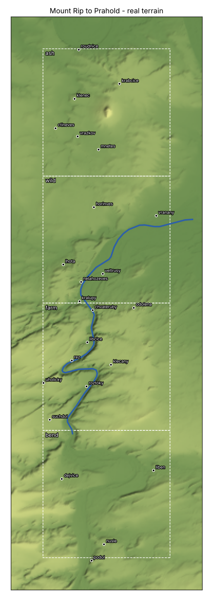

# Terrain tools - real landscapes for campaign regions

Campaign regions built on real places (from Phase 3: the Veltava Bend = Prague) take their heights and rivers from a real
terrain model, not from noise. These scripts turn a raw elevation tile into a small game module
(`campaign/core/dem-<region>.js`) and a preview image. Everything needed to rebuild or extend the maps is here.

## Pipeline

```
sources.json --fetch_sources.py--> .cache/N50E014.hgt         raw tile (not committed, 26 MB)
                --crop.py REGION--> sources/REGION_dtm.png     committed 16-bit crop + REGION_dtm.json bounds
                --bake.py REGION--> campaign/core/dem-REGION.js   game module (heights, river mask, river line)
             --preview.py REGION--> ai_sdlc/001_campaign/img/REGION-terrain.png
```

| File | What |
| --- | --- |
| `sources.json` | Raw tiles: what they are, licence, download URL, sha256 of the zip and the tile |
| `regions/<id>.json` | Region config: tile, crop window, projection (centre lon / lat, metres per game unit), game grid, river tracing parameters, preview labels, the fantasy names with their Czech forms and the real places |
| `sources/<id>_dtm.png` + `.json` | Committed crop of the raw tile (lossless 16-bit PNG, 0.1 m steps, rows north -> south) with its exact bounds, so a bake never depends on the upstream download |
| `fetch_sources.py` | Downloads and checks the raw tiles (only needed for `crop.py`) |
| `crop.py` | Cuts the region window out of the raw tile |
| `bake.py` | Projects the crop onto the game grid, traces the river (least-cost path along the valley floor), marks water at river level, writes the module |
| `preview.py` | Hillshade + water + place names, for specs and reviews |
| `terrain_lib.py` | Shared: config, crop loading, projection |

Requirements: Python 3 with `numpy`, `scipy`, `pillow` (+ `matplotlib` for the preview). Run from the repo root:

```
python3 tools/terrain/bake.py bend          # rebuild campaign/core/dem-bend.js from the committed crop
python3 tools/terrain/preview.py bend       # rebuild the preview image
node campaign/test/run.js                   # dem.test.js checks the module against known Prague heights
```

## Sources and licence

- **Sonny's LiDAR Digital Terrain Model of Europe**, 1 arc second (about 30 m), SRTM `.hgt` tiles; for Czechia it is
  derived from **ČÚZK DMR 5G** (open data). Homepage: https://sonny.4lima.de/
- Tile `N50E014` (50-51 N, 14-15 E, covers Prague) was fetched on 2026-10-31 from a Git LFS copy in
  `pandasoft-zz/CzechTouristMap` (URL and checksums in `sources.json`); the official download is on Sonny's site.
- Licence: CC BY 4.0. Credit in the game and README: *Terrain: ČÚZK (DMR 5G) via Sonny's LiDAR DTM Europe*.
- Considered and not used: ASTER water bodies (`ASTWBDV001_N50E014`) - its mask had no water for the Prague river at this
  resolution, so the river is traced from the terrain instead; OpenStreetMap and tile servers - not reachable from the
  build sandbox.

## Veltava Bend (`regions/bend.json`)

- Crop 14.33-14.53 E, 50.02-50.15 N; projection around 14.4325 E, 50.0905 N at 3.6 m per unit (+X west, +Z north: the game's axes,
  facing north +X is on the left);
  grid 241 x 241 every 10 units, radius 1200 (8.6 km across).
- River traced from the south edge (Podolí) to the north-west edge (Troja / Podbaba), water within 170 units of the
  path and at most 1.2 m above the smoothed river level; result: the real Vltava with its loop and islands.
- Checked: Vyšehrad rock 236 m, Petřín 326 m, Letná 229 m, Vítkov 253 m, river 175-190 m.
- The game exaggerates heights 1.6x (`regions.bend.terrain.exag` in `campaign/core/data.js`) so hills read on a phone.

## The whole kingdom (`regions/world.json`, `world.py`)

The campaign is one continuous world: Mount Rip, the Wildwood, the River Farmlands and the Veltava Bend are squares of
2400 units side by side, north to south (`data.world`, `core/terrain.js` zones). Their common ground is one coarse model
of the whole valley, `campaign/core/dem-world.js`, with the finer Bend and Rip modules blended in over their own squares.

```
python3 tools/terrain/world.py crop      # sources/world_dtm.png (+ .json): every 2nd sample of N50E014, 14.05-14.75 E, 49.98-50.50 N
python3 tools/terrain/world.py bake      # campaign/core/dem-world.js: heights every 20 units + the Vltava's centre line
python3 tools/terrain/world.py places    # game positions (world and region frame) of the real villages in world.json
python3 tools/terrain/world.py preview   # ai_sdlc/001_campaign/img/world-terrain.png
```

- **Warp** (`warp`): game (X west, Z north) -> lon / lat. Prahold (Z <= 1200) and Mount Rip (Z >= 6000) keep 3.6 m per
  unit around their own centres, exactly as `bend.json` and `rip.json`, so the three modules agree; between them the
  scale rises and falls as a cosine bump (to about 6.5 m per unit in the middle) so that Rip lies 7200 units due north of
  Prahold, and the centre line moves from Prague's longitude to Rip's. The game turns metres into units with the Bend's
  exaggeration in the south and Rip's in the north (`data.world.exag`, `offset`), times sqrt(3.6 / scale) in the middle.
- **Grid** (`grid`): X -1800..1800, Z -1800..9000 every 20 units (181 x 541), uint8 heights in 1.25 m steps above 150 m.
- **River** (`river`): least-cost path on the valley floor from the Bend's north-west edge (Podbaba) to the world's east
  edge (toward Mělník), smoothed and simplified, with the level (falling, in metres) at every point. The game joins it to
  the Bend's own river and draws it as a channel (`data.world.river`) and a water ribbon.
- **Places** (`places`): the real villages along the way; their game positions are the starting point of the villages in
  `data.regions.*.city.villages` (moved a little where a village would sit in the river or across a region edge).
- Roads and fields are not baked: `campaign/core/roads.js` lays the roads out when the game starts (A* over this
  terrain), `core/terrain.js` places the fields along them.



## Adding a region

1. Add the tile to `sources.json` if it is new (any SRTM-format 1 arc second tile works), run `fetch_sources.py`.
2. Copy `regions/bend.json`, set the crop, the centre, the scale and the river start / goal areas.
3. `crop.py <id>`, `bake.py <id>`, `preview.py <id>`; look at the preview, tune `river` until the water is right.
4. Commit the crop, the config, the module and the preview; load the module in `campaign/index.html` and `sw.js`
   when the region goes into the game. In the one world a new region also needs an `origin` next to its neighbours
   (multiples of 300), `exits` on the shared sides, and the world crop and grid must cover it.
